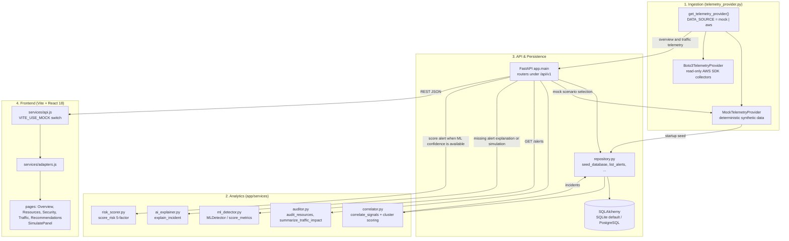
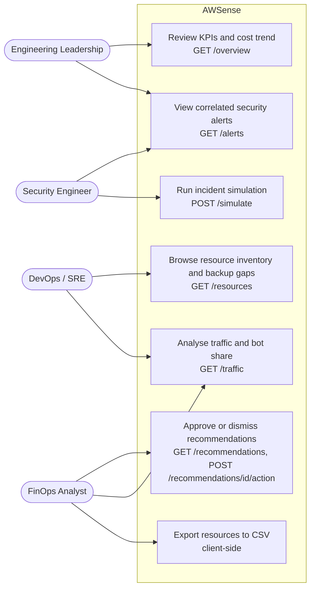
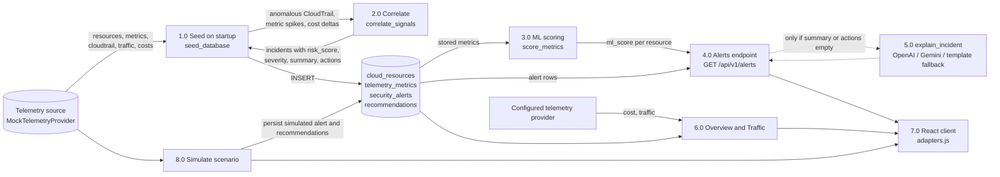
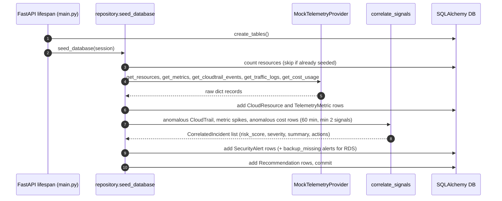
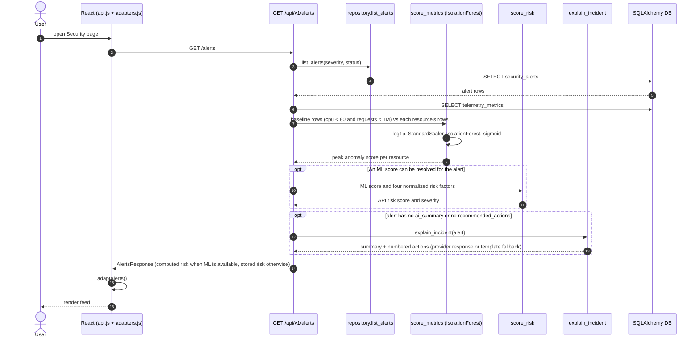
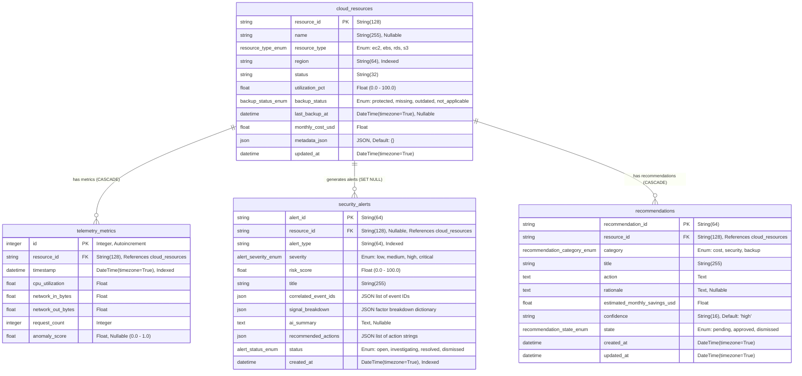

# AWSense — System Analysis, Design & Architecture Specification

## 1. Executive Summary & Problem Statement

Modern enterprise cloud infrastructure hosted on Amazon Web Services (AWS) generates high volumes of disparate, disconnected telemetry data:
- **CloudWatch Metrics & Logs:** High-frequency time-series data reflecting CPU utilization, network traffic, and I/O metrics.
- **AWS CloudTrail:** Immutable API audit trails tracking IAM principals, assumed roles, security group modifications, and resource lifecycle events.
- **AWS Cost Explorer & Billing:** Granular daily and monthly cost allocations, usage records, and service-level financial anomalies.
- **Application & VPC Traffic Logs:** Ingress/egress access logs, bot scrapers, and volumetric request patterns.

### The Siloed Telemetry Challenge
When monitored in isolation, these telemetry streams fail to surface complex, cross-domain incidents:
- A CloudWatch alert for high CPU may be dismissed as a batch job, missing that it originated from an unauthorized instance provisioned by a compromised credential.
- An unusual IAM login in an unused region may appear harmless unless linked to immediate security group openings and subsequent compute spin-ups.
- A sudden increase in billing may only be detected weeks later on the monthly invoice, long after an automated bot scraping attack has inflated auto-scaling groups and egress costs.

### AWSense Mission
**AWSense** bridges the gap between Cloud Security Posture Management (**CSPM**) and Cloud Financial Operations (**FinOps**). By ingesting, normalizing, and correlating heterogeneous telemetry events across time windows, AWSense detects behavioral anomalies, isolates root causes, computes an explainable composite risk score, and delivers automated remediation playbooks.

---

## 2. Requirements & Stakeholder Scope

### 2.1 Stakeholder Profiles & Scope of Interaction

| Stakeholder / Role | Primary Responsibilities | Value Delivered by AWSense | Key Touchpoints |
| :--- | :--- | :--- | :--- |
| **Cloud Security Engineer (SecOps)** | Threat detection, IAM integrity, incident containment, audit compliance | Real-time multi-signal correlation linking suspicious logins to unauthorized infrastructure changes | Security Alert Feed, Incident Timeline, Simulation Drawer |
| **FinOps Practitioner / Cost Analyst** | Cloud financial management, budget forecasting, unit economics | Proactive waste auditing (underutilized EC2, unattached EBS), bot traffic egress cost attribution | Cost Impact Charts, Recommendation Tracker, CSV Export |
| **DevOps / Site Reliability Engineer (SRE)** | System availability, performance optimization, capacity planning | Early warning of abnormal metric spikes, automated backup gap identification | Resource Inventory, Traffic Trends, Health Metric Dashboard |
| **Engineering Leadership (VP / Director)** | Governance, risk reduction, operational expenditure oversight | Unified high-level risk score, executive summary of monthly savings and posture health | Overview KPIs, AI Incident Summaries, Security Risk Gauge |

### 2.2 Functional Requirements (FR)

- **FR-1: Telemetry Ingestion & Provider Abstraction:** Ingest normalized infrastructure configurations, CloudWatch metrics, CloudTrail audit logs, Cost Explorer deltas, and web traffic logs through a provider interface. `MockTelemetryProvider` (deterministic synthetic data) is implemented; `Boto3TelemetryProvider` implements read-only AWS collection.
- **FR-2: Machine Learning Anomaly Detection:** Train an unsupervised multivariate model (`IsolationForest`) on normal baseline metric vectors (`cpu_utilization`, `network_in_bytes`, `network_out_bytes`, `request_count`) and score target rows between `0.0` and `1.0`.
- **FR-3: Temporal Event Correlation:** Group heterogeneous security, performance, and cost events within configurable time windows (default: 60 minutes) based on explicit resource IDs, IAM principals, or regional scope.
- **FR-4: Risk Scoring:** Score correlated incidents on `0–100` with severity tiers. The alert API uses the five-factor `score_risk()` when an ML score is available. See §7.2 and §7.3 for how the stored and returned scores are produced.
- **FR-5: Cloud Waste & Hygiene Auditing:** Continuously inspect EC2 instances for low CPU utilization (<15%), identify unattached EBS storage volumes, and flag stale or missing backups across RDS databases and S3 buckets.
- **FR-6: Scenario Simulation:** Provide on-demand simulation of IAM Credential Breach, Automated Bot Traffic and Resource Waste in offline sample-data mode and via `POST /api/v1/simulate`, which persists the simulated alert and any recommendations.
- **FR-7: AI Narrative & Action Generation:** Synthesize plain-English incident narratives and numbered remediation action steps leveraging OpenAI or Gemini when an API key is set, with a deterministic template otherwise.
- **FR-8: Interactive Web Dashboard:** Provide an accessible, responsive Single Page Application with client-side sorting, "Backup Gaps Only" filtering, sanitization-protected CSV data exports, and instant live/mock data toggling.

### 2.3 Non-Functional Requirements (NFR)

- **NFR-1: Performance & Latency (targets, with a synthetic ML measurement in §11):**
  - REST API responses for overview and resource queries under 200ms.
  - ML scoring of 100 datapoints under 50ms.
- **NFR-2: Security & Principle of Least Privilege:**
  - The AWS collectors require permissions for the specific read-only SDK operations they use.
  - No secrets, credentials, or proprietary tokens stored in version control or browser storage.
  - CSV exports must sanitize formula-injection control characters (`=`, `+`, `-`, `@`, `\t`, `\r`) with leading single quotes.
- **NFR-3: Reliability & Graceful Degradation:**
  - Complete dual-mode operation: the application must fully function in offline mock mode (`VITE_USE_MOCK=true`) without requiring database or backend connectivity.
  - Explanations use a deterministic template when no LLM key is configured or a provider call or response fails (§7.4).
- **NFR-4: Accessibility & Usability:**
  - Interface dialogs comply with WCAG 2.1 AA requirements, including keyboard navigation, focus-trapping inside modal drawers, Escape key closing, and `aria-live` screen reader notifications.
  - Responsive design adapting from desktop down to 375px mobile viewports.

---

## 3. System Architecture & Component Design

### 3.1 Layered System Architecture

The diagram shows the seed flow, the configurable provider paths and the components used by the alert API.



### 3.2 Use Case Diagram



---

## 4. Data Flow Architecture (DFD)

### 4.1 Level-1 Data Flow Diagram (as implemented)



---

## 5. Sequence Diagrams

### 5.1 Ingestion → correlation → persistence (application startup)



### 5.2 Serving alerts (IsolationForest → API → UI)



Seeding stores the correlator score for correlated incidents (§7.2). The alert API computes the five-factor response score when the alert has a usable ML score (§7.3).

---

## 6. Entity-Relationship Data Model (ERD)

The database schema matches the SQLAlchemy ORM models implemented in `backend/app/models/entities.py`. It is designed for cross-database compatibility between SQLite (local development) and PostgreSQL (production).



---

## 7. Algorithms & Methodology

### 7.1 Machine Learning Anomaly Detection (`backend/app/services/ml_detector.py`)

`MLDetector` wraps scikit-learn's `IsolationForest`. Features, in order: `cpu_utilization`, `network_in_bytes`, `network_out_bytes`, `request_count`.

**Pipeline (order matters):**

1. **Validation.** Missing columns, non-numeric values or negative values raise `ValueError`.
2. **`log1p`.** `_prepare()` applies `numpy.log1p` to all four features before they reach the sklearn pipeline, compressing heavy-tailed byte and request counts.
3. **`StandardScaler`.** First step of the sklearn `Pipeline`, fitted on the log-transformed training rows only.
4. **`IsolationForest(n_estimators=200, contamination=0.05, random_state=42)`.** Second step of the pipeline.

**Training.** `fit()` drops rows flagged `is_anomalous == True` when that column exists and requires at least 10 remaining rows. After fitting it stores `score_center` (5th percentile of the training `decision_function` scores) and `score_scale = max(std, 0.05)`.

**Scoring.** With `d` the raw `decision_function` value (lower means more anomalous):

$$S_{ML} = \frac{1}{1 + \exp\left(\mathrm{clip}\left(\frac{d - \text{score\_center}}{\text{score\_scale}}, -50, 50\right)\right)} \in [0,1]$$

`is_anomaly_predicted` is true when `S_ML >= 0.70`.

**Where it runs.** `score_metrics(baseline_rows, target_rows)` fits a fresh detector per call. `GET /alerts` (`app/api/alerts.py`) builds the baseline from all stored `telemetry_metrics` rows with `cpu_utilization < 80` and `request_count < 1,000,000` (needs at least 10), scores each resource's rows, and returns the maximum as `ml_score`. The API resolves an alert-level ML score from the relevant resources or a stored ML score. When available, it uses that value for response scoring (§7.3).

### 7.2 Chronological Signal Correlation (`backend/app/services/correlator.py`)

**Inputs.** Three signal types are normalised into `CorrelatedSignal` objects and sorted by `(timestamp, signal_type, event_id)`:

| Signal | Severity weight `w` (0 to 1) |
| :--- | :--- |
| CloudTrail | `risk_hint` if provided; otherwise 0.30, +0.35 if `is_anomalous`, +0.25 if the event name is in the high-risk set (`ConsoleLogin`, `AssumeRole`, `RunInstances`, `AuthorizeSecurityGroupIngress`, `DeleteTrail`, and 7 others) |
| Metric spike | `anomaly_score` if provided; otherwise with a baseline `b > 0`: `0.25 + min(0.75, ((v-b)/b)/4)`; with no baseline: 0.55 if `v > 0`, else 0.20. In the no-`anomaly_score` branch, CPU or utilization metrics with `v >= 80` are raised to at least 0.75 |
| Cost delta | `0.20 + 0.40*min(1, delta_usd/500) + 0.40*min(1, delta_pct/200)` |

**Grouping.** Signals are processed once, in time order. Each is compared with the open clusters; a cluster can accept it only if the cluster's total span stays within `time_window_minutes` (default 60). Match priority:

1. Shared `resource_id`.
2. CloudTrail only: same known IAM principal with compatible regions (equal, or one side missing).
3. Same region, only when the signal or the cluster has no resource IDs, so two resource-pinned clusters never merge on region alone.

Priority 1 and 2 matches are preferred (the best-ranked cluster wins, and other matching clusters merge into it if the combined span still fits). A priority 3 match attaches to the most recent such cluster. No match starts a new cluster. Clusters smaller than `min_signals` (default 2) are dropped.

**Cluster scoring (the initial score stored for correlated seed alerts).** For each cluster:

- `iam_risk = min(100, 100*max(CloudTrail w) + 5*(n_cloudtrail - 1))`
- `traffic_anomaly = 100*max(w of metric spikes whose name contains request, traffic, bot, network, rpm, rps, egress or bandwidth)`
- `resource_impact = 100*max(w of other metric spikes)`; if there are none, 0.85 × the traffic weights is used; a `RunInstances` or `ModifyDBInstance` event adds a 0.80 candidate
- `cost_impact = 100*max(cost w)`
- `base = 0.55*max(active factors) + 0.45*mean(active factors)` over factors greater than 0
- `risk_score = clamp(base + 8*(distinct signal types - 1) + min(10, 2*max(0, n_signals - 2)), 0, 100)`, rounded to 1 decimal

Severity uses the same cut-offs as §7.3. Incident type is chosen by rule: `iam_compute_surge` (CloudTrail plus a metric, cost or high IAM risk), `bot_traffic_cost_spike` (traffic spike and no CloudTrail), `cost_utilization_anomaly` (metric plus cost), otherwise `correlated_anomaly`.

This cluster formula is separate from the five-factor score returned by the alert API when an ML score is available.

### 7.3 Five-Factor Risk Scoring (`backend/app/services/risk_scorer.py`)

$$\text{risk} = 100\left(0.30\,\tfrac{ml}{1} + 0.25\,\tfrac{iam}{100} + 0.20\,\tfrac{resource}{100} + 0.15\,\tfrac{cost}{100} + 0.10\,\tfrac{traffic}{100}\right)$$

| Factor | Parameter | Range | Weight |
| :--- | :--- | :---: | :---: |
| ML anomaly confidence | `ml_score` | 0 to 1 | 0.30 |
| IAM risk | `iam_risk` | 0 to 100 | 0.25 |
| Resource impact | `resource_impact` | 0 to 100 | 0.20 |
| Cost impact | `cost_impact` | 0 to 100 | 0.15 |
| Traffic anomaly | `traffic_anomaly` | 0 to 100 | 0.10 |

Out-of-range or non-finite inputs raise `ValueError`. The result is rounded to 2 decimals. Severity: `>= 85` critical, `>= 65` high, `>= 40` medium, otherwise low.

**API integration.** The alert response converter calls `score_risk()` when it resolves an ML score. It combines that score with the normalized IAM, resource, cost and traffic factors. The returned score and severity drive severity filtering and result sorting in `GET /alerts`. If an ML score is unavailable, the API returns the persisted score and severity. The status-update endpoint uses the same response converter.

### 7.4 AI Explanation (`backend/app/services/ai_explainer.py`)

`explain_incident(incident: dict)` always builds a deterministic summary and three generic steps. If `OPENAI_API_KEY` (or `LLM_API_KEY`) is set it calls OpenAI Chat Completions (`LLM_MODEL`, default `gpt-4o-mini`); otherwise, if `GEMINI_API_KEY` is set, it calls Gemini (`GEMINI_MODEL`). Steps are returned numbered (`"1. ..."`). The template is returned when no key is configured. Network failures, HTTP errors, timeouts, malformed JSON and invalid response structures also return the template. The warning identifies the provider and exception type without logging the key, incident payload or provider response. `GET /alerts` invokes the explainer when it needs a summary or action list. Backend simulations use it to enrich their responses and persisted alerts.

---

## 8. Incident Simulation (`backend/app/api/simulate.py`)

`POST /api/v1/simulate` with body `{"scenario": "iam_breach" | "bot_traffic" | "resource_waste"}`. The API uses the mock provider to generate scenario findings and recommendations. It ensures the scenario resource exists, uses the explainer for the summary and actions, saves the simulated alert with a scenario-specific ID and commits any generated recommendations as pending.

| Scenario | Backend `risk_score` / severity (findings present) | Fallback (no findings) |
| :--- | :--- | :--- |
| `iam_breach` | 96, critical | 10, low |
| `bot_traffic` | 92, critical | 15, low |
| `resource_waste` | 78, high | 10, low |

Scenario-specific rules produce the simulation response scores above. The frontend offline fixtures have their own scores in `SimulatePanel.jsx`. The Alerts API may recalculate a stored simulation alert's response score if an ML score can be resolved (§7.3).

---

## 9. REST API Surface (verified against `app/main.py` and `app/api/*.py`)

| Method | Path | Notes |
| :--- | :--- | :--- |
| GET | `/` | liveness message |
| GET | `/api/v1/health` | `{"status": "healthy"}` |
| GET | `/api/v1/overview` | KPIs and 30-day cost/CPU/request trend |
| GET | `/api/v1/resources` | inventory, with filters |
| GET | `/api/v1/alerts` | optional `severity`, `status` query params |
| GET | `/api/v1/traffic` | egress, bot share, endpoint patterns |
| GET | `/api/v1/recommendations` | list with total estimated savings |
| POST | `/api/v1/recommendations/{recommendation_id}/action` | body `{"action": "pending" \| "approved" \| "dismissed"}`; 404 if unknown |
| POST | `/api/v1/simulate` | sends a generated scenario response and persists the simulated alert and any recommendations (see §8) |
| POST | `/api/v1/alerts/{alert_id}/status` | body contains `status` (`open`, `investigating`, `resolved`, or `dismissed`); 404 if unknown |

The status endpoint persists the new status and returns the updated alert and its previous status.

Note on backup status: the API and database use `outdated`; the frontend adapter (`adapters.js`) maps it to `stale` for display.

---

## 10. Known Gaps (found during verification)

1. AWS collection requires configured read-only credentials and service access. Startup database seeding still defaults to the mock provider unless a provider is passed explicitly to `seed_database()`.
2. The benchmark in §11 measures synthetic ML inference. The REST response-time targets in §2 still need endpoint-level measurements.
3. `CORS allow_origins=["*"]` in `main.py` is flagged in code as development-only.
4. Python 3.11 or newer is required because the backend uses `enum.StrEnum`.

---

## 11. Verification Record

Historical baseline checked on a fresh clone at commit `e25615e` (Python 3.12.3, Node 22):

| Check | Command | Result |
| :--- | :--- | :--- |
| Backend tests | `cd backend && pytest -q` and `pytest backend/tests -q` from the repo root | 42 passed |
| Frontend adapter tests | `cd frontend && node --test src/services/adapters.test.mjs` | 6 / 6 pass |
| Frontend install and build | `npm ci`, `npm run build` | succeeds (chunk-size warning only) |
| Server start | `uvicorn app.main:app` | all endpoints in §9 returned 200 (`/simulate` with `iam_breach` body) |
| Manual DB seed | command in README Step 4 | `{'resources': 14, 'metrics': 144, 'alerts': 3, 'recommendations': 5}` |
| ERD | compared with `backend/app/models/entities.py` | table names, columns, enums, FKs and ondelete rules match §6 |

Test modules: `test_database`, `test_repository`, `test_correlator`, `test_ml_ai`, `test_api_routes`, `test_auditor_and_simulate`, `test_telemetry_provider`, `test_codebase_smoke`.


### Day 5/6 Explainer and ML Benchmark Verification

Observed on Linux with Python 3.12.14 against the Day 5/6 changes based on commit `026b13b`. Run the following commands from `backend/`:

```console
python -m pytest tests/test_ml_ai.py tests/test_ml_eval.py -v
python -m app.services.ml_eval
```

The targeted run passed **23 tests**, including deterministic fallback for mocked OpenAI and Gemini failures. The benchmark fitted the detector on 120 normal synthetic records and evaluated it on 144 synthetic records at a 0.70 threshold.

| Metric | Observed value |
| :--- | :--- |
| Precision | 100.00% |
| Recall | 100.00% |
| F1 | 100.00% |
| False-positive rate | 0.00% |
| Confusion matrix (actual normal/anomalous rows, predicted normal/anomalous columns) | `[[119, 0], [0, 25]]` |
| Median anomaly score, normal / anomalous | 0.181227 / 0.806729 |
| Score separation (anomalous median minus normal median) | 0.625502 |
| Total inference latency (`inference_ms_total`) | 11.76 ms |

The latency is a single batch prediction measurement for this run. It excludes model fitting and API round-trip time. Classification results apply to the synthetic evaluation set.
